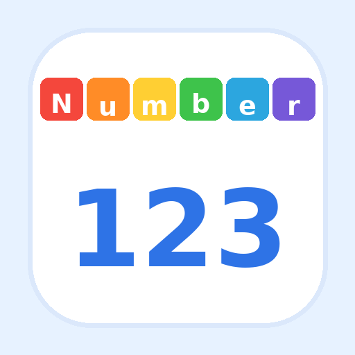

# 数字积木小侦探

一款适合儿童的数字积木网页小游戏。选择难度后，每次进入都会随机生成 10 道题；题目围绕 0–20 的加减与数字规律展开。

[**在线体验**](https://dounaoo.github.io/numberblocks-detective/)



## 怎么玩

- 选择简单、容易、困难或规律题。
- 看题并选择答案，完成一组 10 道题。
- 想再玩一组时重新进入，题目会再次随机生成。

## 版本与文件

此仓库归档 **v34**。`index.html` 已内嵌所需的数字积木图片；`manifest.webmanifest`、`sw.js` 和图标用于在支持的浏览器中安装和离线使用。网页无需构建步骤。

```text
index.html
icon-180.png
icon-512.png
manifest.webmanifest
sw.js
.nojekyll
README.md
```
